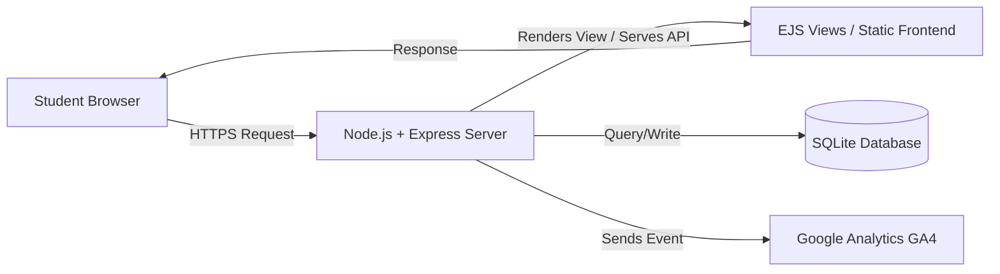
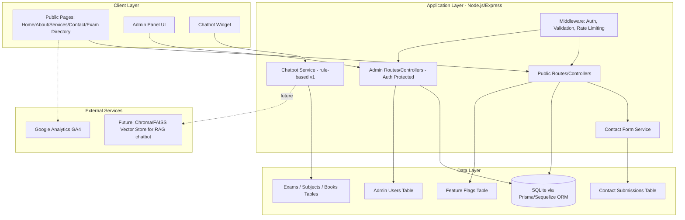
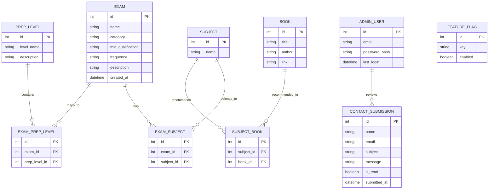
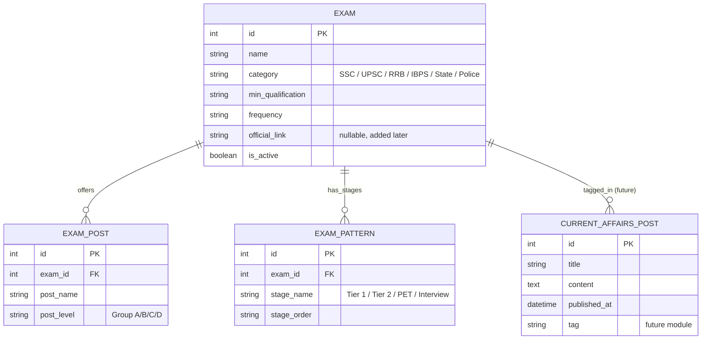
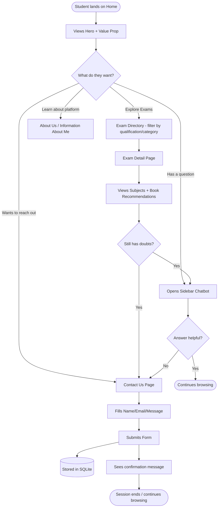
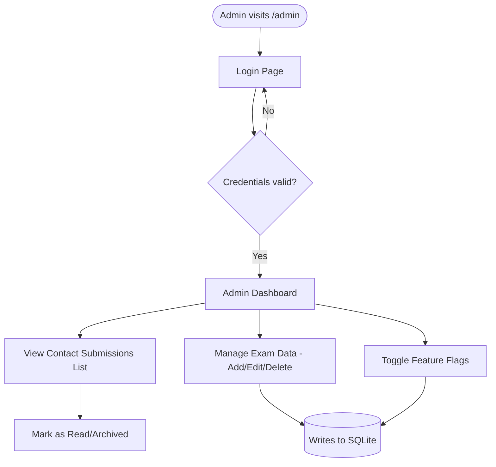

# Architecture Document
## Project: ExamSaathi

**Owner:** Sakshi Bansal · sakshibansal425@gmail.com
**Version:** 1.0

All diagrams below are written in **Mermaid** syntax — they render automatically on GitHub, Notion, Obsidian, and most modern Markdown viewers/VS Code extensions.

---

## 1. High-Level System Diagram (1D — Linear Request Flow)

A simple, linear view of how a single request travels through the system.

---

## 2. Layered Architecture Diagram (2D — System Layers)

A layered view showing how components stack and depend on each other.

---

## 3. Entity Relationship Diagram (ER Diagram)

---

## 4. Enhanced Entity Relationship Diagram (EER — with attribute detail & specialization)

The EER extends the ER model by showing that `EXAM` can specialize into different **posting types**, capturing the "Major Posts" and "Exam Frequency" nuance from the exam data table, plus optional attributes for future extensibility.

> **Note:** `CURRENT_AFFAIRS_POST` is intentionally included as a "future module" entity to demonstrate the schema can grow without breaking existing tables — new tables link back to `EXAM` via foreign keys rather than modifying it.

---

## 5. User Flow Diagram

### 5.1 Student Visitor Flow

### 5.2 Admin Flow

---

## 6. Extensibility Notes (ties back to PRD Section 2.4)
- All new pages/features (e.g., Mock Tests, Blog, Current Affairs) are added as **new Express route modules** + **new Prisma models**, following the same pattern as `EXAM` — no existing table needs to change.
- The **Feature Flag** table lets the admin panel turn modules on/off without a redeploy.
- If the project later migrates from SQLite to **Supabase/Postgres**, only the Prisma `datasource` config changes — schema and application code stay the same.
- If a **graph-based recommendation feature** is added later (e.g., "exams similar to this one"), it can run as a separate **Neo4j** instance fed from the same SQLite data via a sync job, without disrupting the core app.
